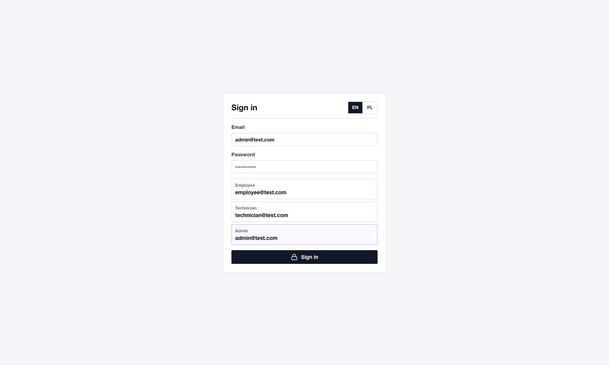
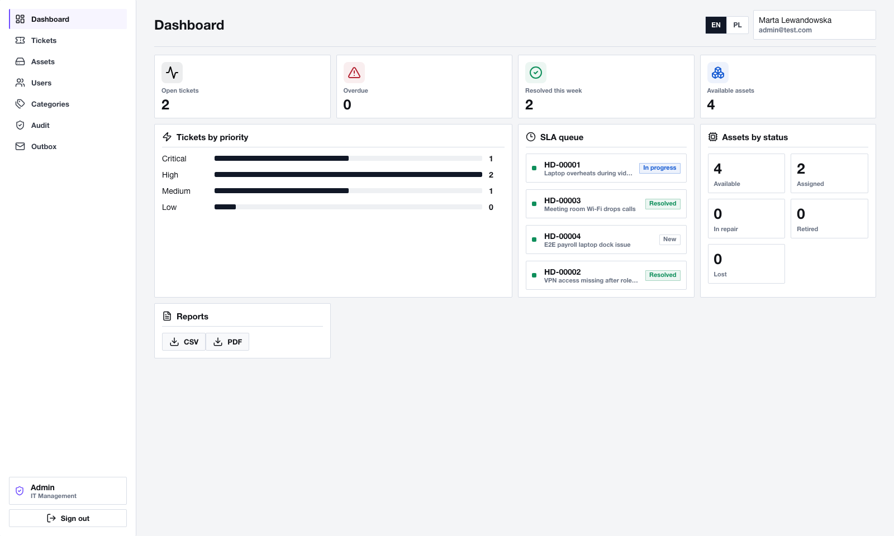
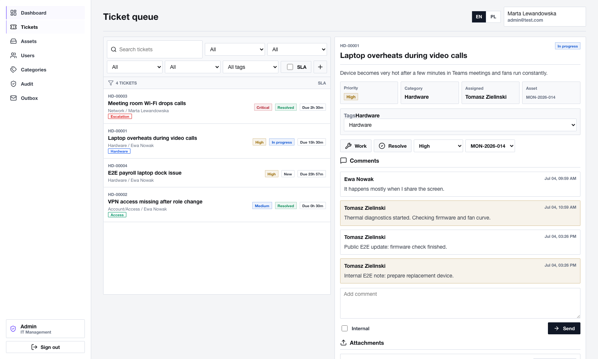
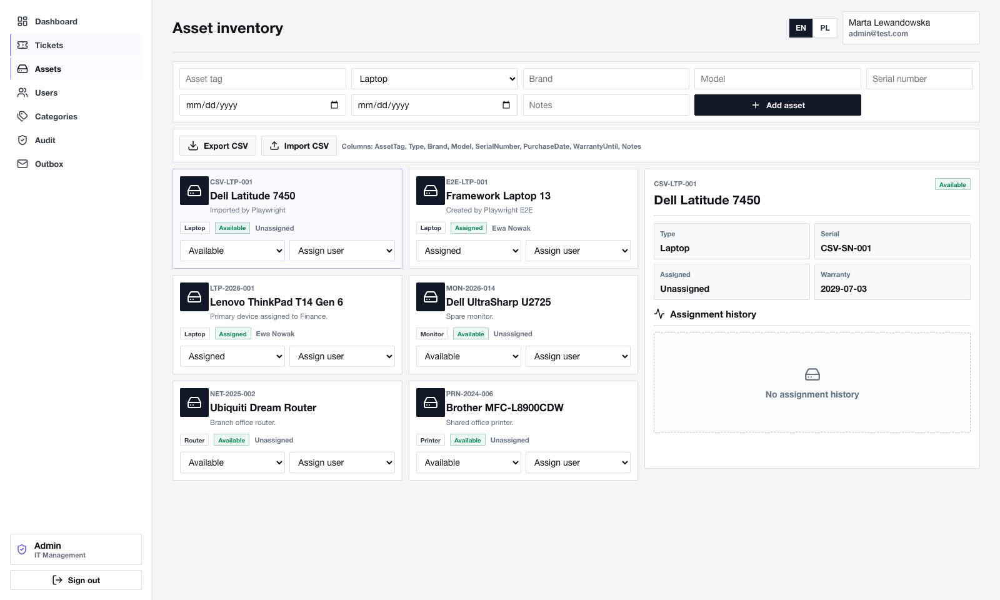
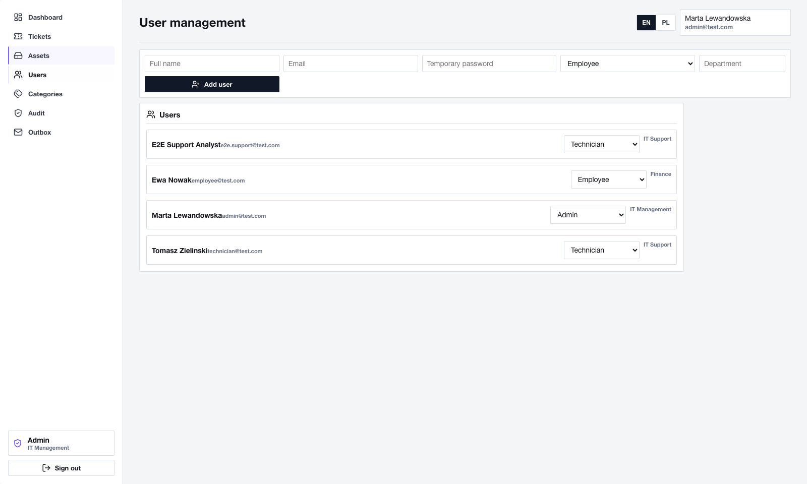
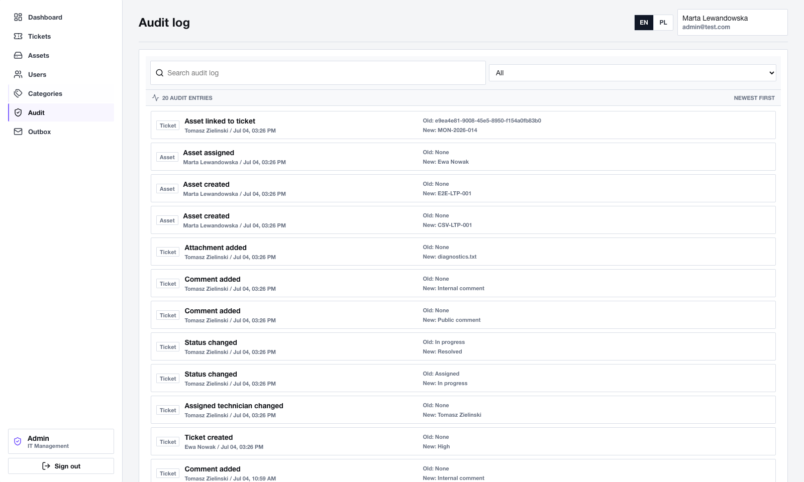
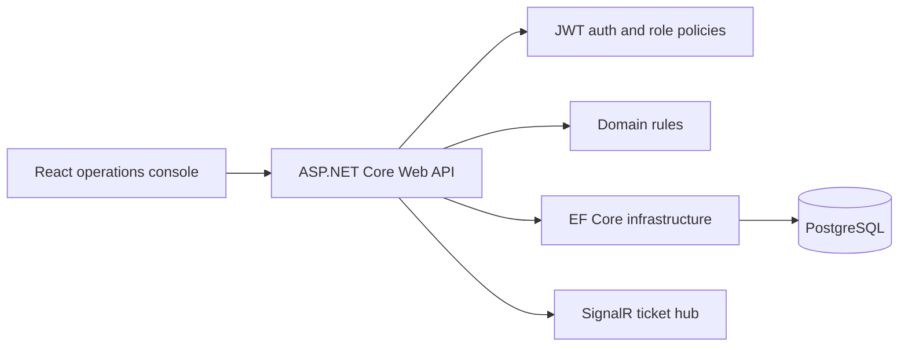
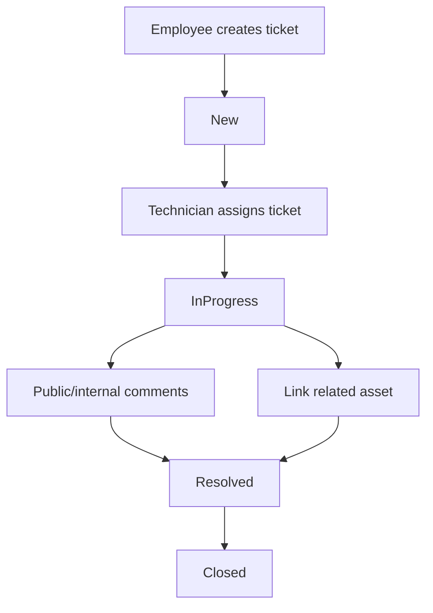
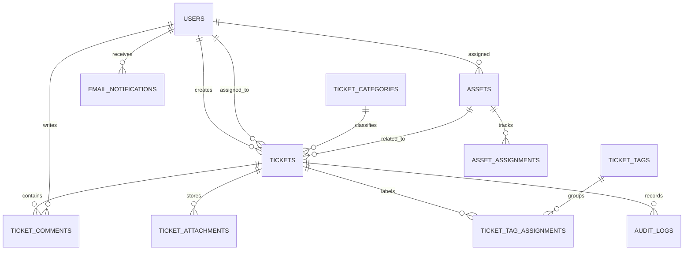

<div align="center">

# IT Helpdesk & Asset Management System

**Full-stack web application for internal IT support, ticket workflows and company asset inventory.**

A portfolio-oriented technical project combining an **ASP.NET Core Web API**, **React + TypeScript** operations console and **PostgreSQL** relational database. The system covers role-based helpdesk work, ticket lifecycle management, comments, internal notes, SLA tracking, audit history, asset assignment, dashboard reporting, CSV/PDF exports, Playwright E2E tests and Docker-based local setup.

<br />


<br />

<a href="#screenshots">Screenshots</a> |
<a href="#main-features">Features</a> |
<a href="#architecture">Architecture</a> |
<a href="#running-locally">Running Locally</a> |
<a href="#tests-and-qa">Tests</a>

</div>

---

## Project Snapshot

<table>
  <tr>
    <td><strong>Context</strong><br />Portfolio project based on an internal IT support and asset management brief.</td>
    <td><strong>Backend</strong><br />ASP.NET Core Web API with layered projects, JWT auth and role-based authorization.</td>
    <td><strong>Database</strong><br />PostgreSQL, Entity Framework Core migrations, relational constraints and seed data.</td>
    <td><strong>Frontend</strong><br />React operations console with a minimal dark UI, PL/EN switch and stable SPA URLs.</td>
  </tr>
</table>

## Author

- Robert Tworek

---

## Screenshots

<table>
  <tr>
    <td width="50%">
      <h3>Login and demo accounts</h3>
      <p>The login screen exposes seeded Employee, Technician and Admin accounts for quick local review.</p>
      
    </td>
    <td width="50%">
      <h3>Operational dashboard</h3>
      <p>The dashboard summarizes open tickets, overdue SLA items, recently resolved work and asset availability.</p>
      
    </td>
  </tr>
  <tr>
    <td width="50%">
      <h3>Ticket queue</h3>
      <p>Technicians can filter tickets, assign work, change status, add comments, link assets and review history.</p>
      
    </td>
    <td width="50%">
      <h3>Asset inventory</h3>
      <p>Admins can create assets, import/export CSV files, change status and assign devices to users.</p>
      
    </td>
  </tr>
  <tr>
    <td width="50%">
      <h3>User and role management</h3>
      <p>Admin users can create accounts and switch roles between Employee, Technician and Admin.</p>
      
    </td>
    <td width="50%">
      <h3>Audit log</h3>
      <p>The audit view tracks ticket and asset operations with actor, entity and old/new value context.</p>
      
    </td>
  </tr>
</table>

---

## What The Project Shows

This repository demonstrates a complete business-style application rather than isolated CRUD screens.

<table>
  <tr>
    <td width="64"><strong>01</strong></td>
    <td><strong>Role-based support workflow</strong><br />Employee, Technician and Admin users have different permissions and UI access.</td>
  </tr>
  <tr>
    <td><strong>02</strong></td>
    <td><strong>Relational domain model</strong><br />Tickets, users, categories, comments, tags, attachments, audit logs, assets and assignments are modeled with EF Core and PostgreSQL.</td>
  </tr>
  <tr>
    <td><strong>03</strong></td>
    <td><strong>Practical frontend application</strong><br />The React console focuses on operational density, filters, forms, state transitions and real user workflows.</td>
  </tr>
  <tr>
    <td><strong>04</strong></td>
    <td><strong>Testing and delivery discipline</strong><br />The project includes unit tests, API integration tests, browser E2E tests, Docker Compose and GitHub Actions.</td>
  </tr>
</table>

The application includes seeded demo accounts, JWT authentication, status transition rules, public/internal comments, SLA calculation, audit tracking, CSV/PDF reporting, asset assignment history and a documented LDAP/Active Directory integration concept.

---

## Main Features

| Area | Implemented Scope |
| --- | --- |
| Authentication | JWT login, seeded demo users and current-user endpoint |
| Roles | Employee, Technician and Admin authorization boundaries |
| Ticket queue | Search, status filter, priority filter, category filter, assigned technician filter, tag filter and overdue-only filter |
| Ticket details | Description, priority, category, assignment, linked asset, comments, attachments, tags and timeline history |
| Workflow | Create ticket, assign technician, change status, change priority, resolve and close |
| Comments | Public comments for all participants and internal comments hidden from Employees |
| Attachments | Authenticated upload, metadata listing and file download |
| SLA | Priority-based due dates and overdue indicators |
| Tags | Admin-configurable ticket tags, assignment endpoint and queue filtering |
| Assets | Inventory creation, status changes, assignment rules and assignment history |
| CSV | Asset CSV import/export from the operations console |
| Dashboard | Open tickets, overdue tickets, resolved-this-week count, available assets and grouped status/priority metrics |
| Reports | Admin CSV/PDF dashboard export endpoints |
| Audit | Global admin audit log for ticket and asset operations |
| Notifications | Email notification outbox entries after ticket status changes |
| Localization | English/Polish UI switch for operational labels |
| Routing | Stable SPA URLs for dashboard, tickets, assets, admin settings, audit and notifications |
| Realtime foundation | Backend SignalR hub publishing ticket change events |
| DevOps | Docker Compose, GitHub Actions, launch scripts for macOS and Windows |

---

## Technologies

<table>
  <tr>
    <td><strong>Backend</strong></td>
    <td>ASP.NET Core 10 Web API, C#, JWT bearer authentication, SignalR</td>
  </tr>
  <tr>
    <td><strong>Application</strong></td>
    <td>Layered .NET solution with Domain, Application, Infrastructure and API projects</td>
  </tr>
  <tr>
    <td><strong>Database</strong></td>
    <td>PostgreSQL, Entity Framework Core, migrations, seed data and relational mapping</td>
  </tr>
  <tr>
    <td><strong>Frontend</strong></td>
    <td>React 19, TypeScript 6, Vite 8, lucide-react, responsive operations UI</td>
  </tr>
  <tr>
    <td><strong>Testing</strong></td>
    <td>xUnit, Testcontainers for PostgreSQL, Playwright, oxlint</td>
  </tr>
  <tr>
    <td><strong>Tooling</strong></td>
    <td>Docker Compose, GitHub Actions, macOS <code>.command</code> launcher and Windows <code>.bat</code> launcher</td>
  </tr>
</table>

---

## Architecture



The application is split into focused projects:

| Project | Responsibility |
| --- | --- |
| `src/Helpdesk.Domain` | Business entities and rules for tickets, SLA, assets, audit logs, notifications and users |
| `src/Helpdesk.Application` | DTO contracts and report helpers used by API responses |
| `src/Helpdesk.Infrastructure` | EF Core context, PostgreSQL mapping, migrations, password hashing and seed data |
| `src/Helpdesk.Api` | Controllers, JWT auth, role policies, SignalR hub and startup database migration |
| `frontend` | React + TypeScript operations console |
| `tests/Helpdesk.UnitTests` | Domain behavior tests |
| `tests/Helpdesk.IntegrationTests` | API tests against isolated PostgreSQL Testcontainers |
| `frontend/e2e` | Playwright browser scenarios |

### Core Workflow



### Data Model



More details are available in [docs/architecture.md](docs/architecture.md).

---

## API Surface

| Module | Endpoints |
| --- | --- |
| Auth | `POST /api/auth/login`, `GET /api/auth/me` |
| Tickets | `GET /api/tickets`, `GET /api/tickets/{id}`, `POST /api/tickets` |
| Ticket workflow | `PATCH /api/tickets/{id}/status`, `PATCH /api/tickets/{id}/assign`, `PATCH /api/tickets/{id}/priority` |
| Ticket collaboration | `POST /api/tickets/{id}/comments`, `POST /api/tickets/{id}/attachments`, `GET /api/tickets/{id}/attachments/{attachmentId}` |
| Ticket metadata | `GET /api/tickets/categories`, `GET /api/tickets/tags`, `PATCH /api/tickets/{id}/tags` |
| Assets | `GET /api/assets`, `GET /api/assets/{id}`, `POST /api/assets`, `PUT /api/assets/{id}`, `PATCH /api/assets/{id}/assign`, `PATCH /api/assets/{id}/status` |
| Dashboard | `GET /api/dashboard/summary`, chart endpoints for tickets and assets |
| Reports | `GET /api/reports/dashboard.csv`, `GET /api/reports/dashboard.pdf` |
| Admin | `GET /api/users`, `POST /api/users`, `PATCH /api/users/{id}/role`, category and tag management |
| Audit | `GET /api/audit` |
| Notifications | `GET /api/notifications/email` |
| Realtime | `/hubs/tickets` SignalR hub |

---

## Security And Access Control

| Mechanism | Purpose |
| --- | --- |
| Password hashing | Seeded and created users store hashed passwords |
| JWT authentication | API endpoints require bearer tokens except login |
| Role authorization | Employee, Technician and Admin workflows are separated |
| Internal comments | Technician/Admin internal notes are hidden from Employee users |
| Audit logs | Important ticket and asset operations are written to audit records |
| File size guard | Ticket attachments are limited before storage |
| Admin-only exports | Report exports, global audit log and management screens require Admin access |

The demo configuration is intended for local review. Production deployment should replace demo secrets, configure proper identity infrastructure and move sensitive values into environment-specific secret storage.

---

## Project Structure

```text
it-helpdesk-asset-management-system/
|-- .github/
|   `-- workflows/
|       `-- ci.yml
|-- docs/
|   |-- screenshots/
|   |-- architecture.md
|   |-- ldap-active-directory.md
|   `-- qa-report.md
|-- frontend/
|   |-- e2e/
|   |-- nginx/
|   |-- public/
|   |-- src/
|   |   |-- components/
|   |   |-- styles/
|   |   |-- api.ts
|   |   |-- demoData.ts
|   |   |-- formatting.ts
|   |   |-- i18n.ts
|   |   |-- types.ts
|   |   `-- views.tsx
|   |-- scripts/
|   |   `-- capture-screenshots.mjs
|   |-- Dockerfile
|   |-- package.json
|   `-- playwright.config.ts
|-- src/
|   |-- Helpdesk.Api/
|   |-- Helpdesk.Application/
|   |-- Helpdesk.Domain/
|   `-- Helpdesk.Infrastructure/
|-- tests/
|   |-- Helpdesk.IntegrationTests/
|   `-- Helpdesk.UnitTests/
|-- docker-compose.yml
|-- ItHelpdesk.slnx
|-- start-helpdesk-macos.command
|-- start-helpdesk-windows.bat
`-- README.md
```

---

## Running Locally

### Requirements

- Docker Desktop with Docker Compose plugin
- Free local ports:
  - frontend: `5173`
  - API: `5080`
  - PostgreSQL: `5432`

### One-click launchers

macOS:

```bash
./start-helpdesk-macos.command
```

Windows:

```bat
start-helpdesk-windows.bat
```

Both launchers start the Docker Compose stack in detached mode and open the frontend.

### Manual start

```bash
docker compose up --build
```

Application URLs:

| Service | URL |
| --- | --- |
| Frontend | `http://localhost:5173` |
| API | `http://localhost:5080` |
| PostgreSQL | `localhost:5432` |

Stop services:

```bash
docker compose down
```

The API applies EF Core migrations and seeds demo data on startup.

---

## Demo Accounts

| Role | Email | Password |
| --- | --- | --- |
| Employee | `employee@test.com` | `Password123!` |
| Technician | `technician@test.com` | `Password123!` |
| Admin | `admin@test.com` | `Password123!` |

Role summary:

| Role | What it can do |
| --- | --- |
| Employee | Create own tickets, add public comments, view own assets and close resolved tickets |
| Technician | Work the queue, assign tickets, update status/priority, add internal comments and link assets |
| Admin | Manage users, assets, categories, tags, audit log, outbox and dashboard reports |

---

## Run Without Docker

Backend build and unit tests can be run directly:

```bash
dotnet restore ItHelpdesk.slnx
dotnet build ItHelpdesk.slnx
dotnet test tests/Helpdesk.UnitTests/Helpdesk.UnitTests.csproj
dotnet run --project src/Helpdesk.Api/Helpdesk.Api.csproj --urls http://localhost:5080
```

Integration tests require Docker because they start an isolated PostgreSQL container:

```bash
dotnet test tests/Helpdesk.IntegrationTests/Helpdesk.IntegrationTests.csproj
```

Frontend:

```bash
cd frontend
npm install
VITE_API_URL=http://127.0.0.1:5080 npm run dev
```

Frontend checks:

```bash
npm run lint
npm run build
npx playwright install chromium
PLAYWRIGHT_PORT=5173 VITE_API_URL=http://127.0.0.1:5080 npm run e2e -- --workers=1
SCREENSHOT_BASE_URL=http://127.0.0.1:5173 npm run screenshots
```

---

## Tests And QA

The latest local QA notes are available in [docs/qa-report.md](docs/qa-report.md).

Most recent verification:

| Check | Result |
| --- | --- |
| Frontend lint | Passed |
| Frontend production build | Passed |
| Backend build | Passed, 0 warnings |
| Backend unit tests | Passed, 14/14 |
| Browser E2E tests | Passed, 9/9 |
| Role permission smoke test | Passed for Employee and Technician restrictions |
| README screenshots | Refreshed from frontend connected to the local API |
| Backend integration tests | Require Docker/Testcontainers |

The Playwright suite covers:

- PL/EN language switch and stable SPA URLs
- Employee ticket creation
- Technician ticket assignment, status changes and resolution
- Public and internal comments
- Employee visibility restrictions for internal comments
- Attachment upload and download
- Asset CSV import/export
- Asset creation and assignment
- Asset-ticket linking
- Admin user management
- Admin ticket category management

GitHub Actions runs backend build/tests, frontend lint/build/E2E and Docker Compose configuration validation.

---

## Documentation

| Document | Description |
| --- | --- |
| [docs/architecture.md](docs/architecture.md) | Project modules, role model, API surface and ER diagram |
| [docs/ldap-active-directory.md](docs/ldap-active-directory.md) | LDAP/Active Directory integration concept |
| [docs/qa-report.md](docs/qa-report.md) | Latest QA pass, test matrix and Docker note |
| [Plan projektu IT Helpdesk.pdf](Plan%20projektu%20IT%20Helpdesk.pdf) | Original Polish project brief |

---

## What I Was Responsible For

- Domain model and workflow rules
- EF Core relational mapping and PostgreSQL setup
- JWT authentication and role-aware API endpoints
- Ticket, comment, attachment, audit, notification and asset modules
- React operations console and minimalist technical UI
- PL/EN interface switch
- Unit, integration and E2E test coverage
- Docker Compose, launch scripts and GitHub Actions
- README, screenshots and architecture documentation

---

## Possible Future Improvements

These are intentionally left as future work rather than required scope for the portfolio-ready build:

- SMTP worker for processing queued email notifications
- Frontend subscription to the existing SignalR ticket update hub
- LDAP/Active Directory proof-of-concept adapter behind an authentication mode flag
- CSV import template download for assets
- More granular dashboard date filters
- Optional object storage adapter for attachments

---

## Current Limitations

- Docker Desktop is required for full local stack startup and integration tests.
- The email notification outbox is stored and visible, but messages are not sent by an SMTP worker yet.
- The backend publishes SignalR ticket events, but the frontend does not subscribe to them yet.
- LDAP/Active Directory is documented as an integration concept, not implemented as a runtime auth provider.
- Demo secrets and seeded passwords are for local review only and must be replaced for production.

---

## GitHub / CV Summary

**IT Helpdesk & Asset Management System**  
ASP.NET Core, React, TypeScript, PostgreSQL, Entity Framework Core, Docker

Full-stack web application for managing internal IT support tickets and company assets. Includes role-based access control, ticket workflow, public/internal comments, attachments, SLA calculation, audit history, asset assignment, dashboard statistics, PostgreSQL relational persistence, CSV/PDF exports, API tests, Playwright E2E tests and Docker-based local setup.
