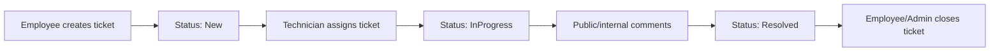
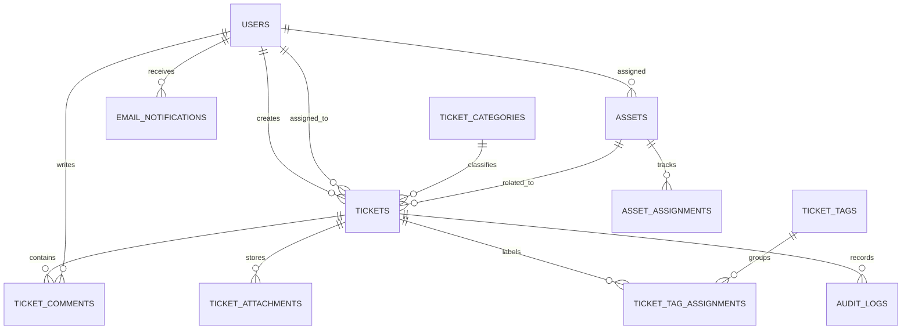

# Architecture

## Modules

- `src/Helpdesk.Domain` - business entities and rules: ticket workflow, SLA policy, ticket tags, notification outbox and asset assignment guards.
- `src/Helpdesk.Application` - DTO contracts and small export helpers used by the API and frontend-facing responses.
- `src/Helpdesk.Infrastructure` - EF Core PostgreSQL context, migrations, relational mapping, password hashing and seed data.
- `src/Helpdesk.Api` - ASP.NET Core controllers, JWT auth, role-based authorization and startup database migration.
- `frontend` - React + TypeScript operations console built with Vite, including asset CSV import/export.
- `tests/Helpdesk.UnitTests` - domain workflow tests for SLA, ticket transitions and asset guards.
- `tests/Helpdesk.IntegrationTests` - API tests against an isolated PostgreSQL container.
- `frontend/e2e` - Playwright scenarios for the main user workflows.

## Core Flow

## Data Model

## Roles

- `Employee` creates and follows own tickets, adds public comments and can close resolved tickets.
- `Technician` works the queue, assigns tickets, changes status/priority, links assets and adds internal comments.
- `Admin` manages users, assets and global dashboard data.

## API Surface

- `/api/auth/login` - JWT login for seeded demo accounts.
- `/api/auth/me` - current authenticated user.
- `/api/tickets` - list/create tickets with status, priority, category, technician, SLA and search filters.
- `/api/tickets?tagIds=...` - ticket queue filtering by assigned tags.
- `/api/tickets/categories` - active category list plus admin-only category creation/update.
- `/api/tickets/categories/manage` - admin-only category configuration list.
- `/api/tickets/tags` - ticket tag list plus admin-only tag creation/update.
- `/api/tickets/{id}` - ticket details with public/internal comments, attachments and audit history.
- `/api/tickets/{id}/attachments` - authenticated ticket attachment upload and download.
- `/api/tickets/{id}/tags` - technician/admin tag assignment for a ticket.
- `/api/assets` - asset inventory with creation, assignment and status changes.
- `/api/assets/{id}` - asset details with current owner and assignment history.
- `/api/dashboard/*` - summary and chart data for support operations.
- `/api/reports/dashboard.csv` - admin-only CSV export for dashboard metrics.
- `/api/reports/dashboard.pdf` - admin-only PDF export for dashboard metrics.
- `/api/users` - admin-only user creation and role management.
- `/api/audit` - admin-only global audit log for ticket and asset operations, with filters for entity, action, user and date range.
- `/api/notifications/email` - admin-only email notification outbox preview.
- `/hubs/tickets` - authenticated SignalR hub publishing `TicketChanged` events.

## External Identity

The runnable demo uses local seeded accounts. A production LDAP/Active Directory integration is described in [`ldap-active-directory.md`](ldap-active-directory.md), including group-to-role mapping and local shadow users for relational workflow data.
